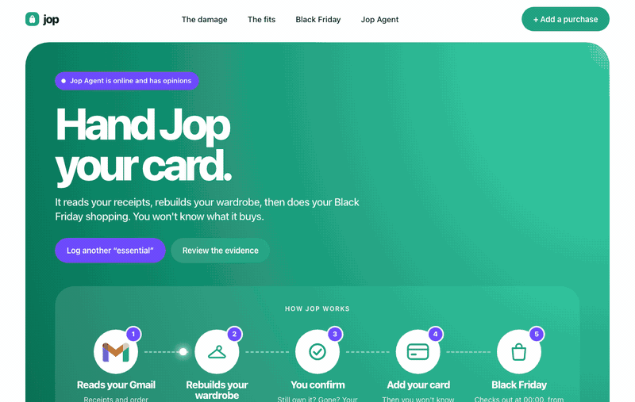
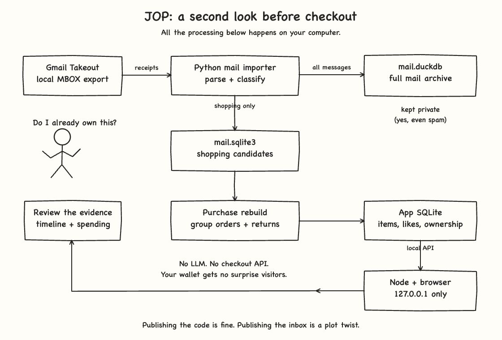

# JOP — pause before you purchase

**Your wardrobe has a history. Read it before buying more.**

JOP is a local wardrobe and purchase-history app for people who want to reduce impulse purchases: the sale-driven, emotional, or accidental buys that feel essential at checkout and spend the next year in a drawer.

Import order emails from a Gmail export, review what you own, and see which brands and categories you keep, like, dislike, or return. Use that evidence to decide whether the next purchase fills a need. Buying nothing is a valid result.



*The GIF uses fictional sample inventory and AI-generated product images. No personal emails or purchase records are shown.*

## What you can do

- **Rebuild purchase history.** Group order, delivery, and return emails into item records, with brand, size, colour, price, and purchase date where the receipts support them.
- **Review your wardrobe.** Browse photos on a zoomable timeline; mark an item liked, disliked, or no longer owned. Like and Dislike are mutually exclusive.
- **See spending clearly.** Filter by brand, year, and clothing type. Compare yearly totals stacked by brand or category, switch to months for a single year, and open a bar to see the items behind it.
- **Recognize patterns.** Insights summarize buying, likes, dislikes, returns, and purchase timing as the filters change.
- **Pause before a sale.** Use the example budget planner to spot duplicates and compare a possible purchase with what is already in your inventory.

The app runs without an account, API key, LLM, or Gmail connection. The “Before you buy” suggestions are simple rules against example wardrobe targets, not personalized AI advice. Sale products and prices are fictional examples. JOP does not connect to a retailer or make purchases.

## Try the demo

Install **Node.js 22.13 or newer**, then run from the repository root:

```sh
npm start
```

Open **http://127.0.0.1:3000**. No npm packages need installing.

A new database starts with 49 fictional wardrobe items and bundled photos. To keep the demo separate from your own data:

```sh
JOP_DATA_DIR="$HOME/.local/share/jop-demo" PORT=3001 npm start
```

Use **Inventory** to explore the sample timeline. Try a year or brand filter, open a chart bar, and use the photo buttons to mark what you like or no longer own. Everything you edit stays in that local database.

## Set up your own wardrobe

The full email-import workflow requires **Python 3.10+** and the **DuckDB CLI** on your PATH. Check your tools:

```sh
node --version
python3 --version
duckdb --version
```

Install DuckDB using its [official installation instructions](https://duckdb.org/docs/installation/). The Python scripts use only the standard library; the app uses Node's built-in SQLite.

### 1. Export your Gmail data

1. Go to [Google Takeout](https://takeout.google.com/) and select **Deselect all**.
2. Select **Mail**. Under **All Mail data included**, choose relevant shopping labels or keep all mail for broader receipt coverage.
3. Choose **Next step**, a one-time export, ZIP format, and delivery by email download link.
4. Download every archive part. Extract the Mail export locally and find the `.mbox` file inside `Takeout/Mail/`. More than one MBOX may be present.
5. Keep the original MBOX in a private location **outside every Git checkout**. The purchase importer uses it later to inspect receipt HTML; moving or changing it can prevent photo and detail recovery.

See [Google's export instructions](https://support.google.com/accounts/answer/3024190?hl=en) and [Gmail export contents](https://support.google.com/mail/answer/10016932?hl=en). Google prepares the export separately; no Gmail credentials belong in this project.

### 2. Build the mail archive and shopping index

The two-database importer takes an **extracted MBOX**, not a ZIP. It creates a full DuckDB archive and a shopping-only SQLite index.

```sh
python3 scripts/import_takeout_duckdb.py "/path/to/export.mbox" \
  --output-dir "$HOME/.local/share/jop-mail/archive-1"
```

The output directory must be outside a Git checkout and must not already contain either output database:

| File | Contents |
| --- | --- |
| `mail.duckdb` | All MBOX messages, including spam and trash, with text, headers, source offsets, and attachment metadata |
| `mail.sqlite3` | Shopping candidates and an SQLite full-text index; junk and most promotions are excluded |

This can take time and substantial disk space for a large mailbox. The original MBOX remains intact. Attachments are not parsed, and the DuckDB archive does not replace the original MIME source.

### 3. Create an empty app database

Run this in a terminal, then **stop it with Ctrl-C** once the app has started:

```sh
JOP_SEED=empty JOP_DATA_DIR="$HOME/.local/share/jop" npm start
```

`JOP_SEED=empty` only affects a new, empty database. It does not remove sample items from an existing database. Use a new data directory if you already tried the demo.

### 4. Rebuild purchases into that same database

```sh
python3 scripts/rebuild_wardrobe_history.py \
  --source "$HOME/.local/share/jop-mail/archive-1/mail.sqlite3" \
  --target "$HOME/.local/share/jop/jop.db" \
  --default-currency CAD
```

By default, the importer retains all apparel audiences. For a men's wardrobe that excludes items explicitly identified as women's or children's, add `--audience men`. Unisex and unclassified items remain. Review the result: an email cannot establish who actually owns an item.

To combine mailbox exports, import each MBOX into its own new directory, then repeat `--source` for the purchase rebuild. Keep existing sources in the same order and append new ones. Later sources are checked for duplicate messages. A rebuild without `--source` reuses that target database's saved source list.

The purchase rebuild replaces its generated history tables in a transaction. It preserves manually entered inventory and tries to retain purchase IDs, likes, and ownership markings. **Back up your app database before a rebuild**; changed receipt evidence can change item identity. Stop the app before copying a SQLite database, or use SQLite's backup command.

### 5. Start and review

```sh
JOP_DATA_DIR="$HOME/.local/share/jop" npm start
```

Use **Purchases** for receipt history and **Inventory** for manually recorded possessions. Imported purchase lines are not automatically copied into editable inventory. Suggestions and the example sale planner currently use Inventory; charts, Insights, and the timeline use the selected source.

Check sizes, quantities, dates, currency, and return evidence. Use **Still in my wardrobe** when an item was retained despite a return notice, and **No longer in my wardrobe** for gifts, donations, and discarded items. Email parsing is heuristic; retailer template changes and in-store or attachment-only receipts can leave gaps.

## Architecture



The [editable SVG](docs/architecture.svg) is an original sketch-style diagram. No XKCD artwork is reproduced.

## Reading the numbers

- The timeline begins in 2019 and hides underwear and running half tights.
- Item-level return requests and reported returns are hidden by default; a refund alone does not prove an item left your wardrobe.
- Pending return requests are excluded from spending aggregates. A retained-ownership marking can restore visibility without changing the receipt's original return status.
- Money totals use one currency at a time. Missing receipt currency defaults to `--default-currency` (CAD unless changed) and is marked as assumed. There is no exchange-rate conversion.
- Recorded item prices exclude order-level tax and shipping. Quantity is applied according to whether a price was recorded per unit or for the whole line.
- Unknown price and purchase date stay blank. Undated inventory appears separately and does not count toward spending.
- A receipt shows what was ordered, not necessarily what is still owned. Use wardrobe markings to correct the picture.
- Day and hour Insights use purchase dates and confirmation emails as estimates. Hour calculations currently use America/Toronto time.

## Privacy and publication

**Publish the code, not your mail or database.** The server listens only on `127.0.0.1`, has no login, and is intended for personal local use. Do not expose it through a public tunnel or deploy a populated database.

Raw mail, database indexes, preferences, ownership markings, and uploaded photos are private. Git ignores common data and archive formats, but ignores do not remove files or identities from old commits.

```sh
npm run check:privacy
python3 scripts/check_public.py --history
npm run release:public
```

The release command creates `dist/jop-public.zip` from an allowlist of source and documentation, excluding `.git` and runtime data. It refuses to overwrite an existing release. Inspect the ZIP before uploading. It carries no commit history, so it does not carry historical author emails.

For an existing GitHub repository, a clean source ZIP does not clean the repository's old branches, tags, or commit metadata. Review those separately before making it public. See [PRIVACY.md](PRIVACY.md).

The importer makes no mail-service or model API calls. The app can load allowlisted public catalog images recovered from receipts, which makes requests to those image hosts. Bundled demo images are local. No analytics or telemetry are included.

## Development

```sh
npm test
python3 -m unittest discover -s tests -p 'test_*.py'
npm run check:privacy
```

| Path | Purpose |
| --- | --- |
| `server.js` | Local HTTP API, SQLite schema, validation, and file uploads |
| `seed.js` | Fictional sample inventory |
| `public/` | Browser UI and generated demo images |
| `scripts/` | Mail import, purchase reconstruction, privacy checks, and clean release export |
| `tests/` | Isolated API and synthetic email-import checks |
| `docs/` | Demo GIF and architecture sketch |

Optional receipt search: `python3 scripts/archive.py --data-dir "/path/to/archive-1" search 'subject:"order confirmation"'`.

The code is an early local prototype. Receipt templates, category rules, date estimates, and photo matches need human review. There is no claim that using the app will produce a particular financial or behavioural outcome.
